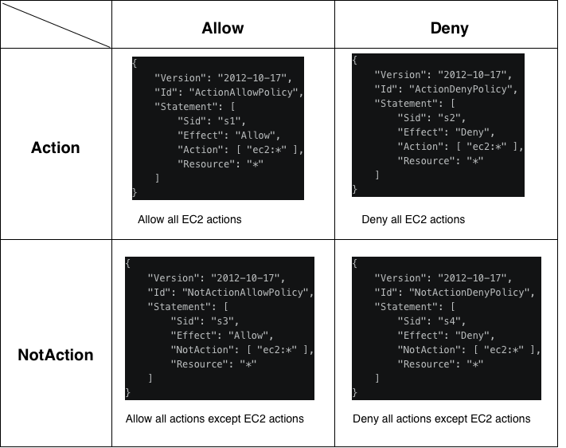

# Domain 4: Identity and Access Management

**NOTE:**  
A general IAM entity ARN looks like:
```
arn:aws:iam::<account-id>:<entity-type>/<division>/<sub-division>/<entity-name-or-id>
```

#### 1. In an IAM policy, you cannot use special characters (NOT even underscore) in "Sid", but you can in "id"

#### 2. Significance of the below statement is that the policy explicitly denies every non-IAM action when MFA is NOT present:
```
{
    "Version": "2012-10-17",
    "Statement": [
        {
            "Effect": "Deny",
            "NotAction": "iam:*",
            "Resource": "*",
            "Condition": {
                "BoolIfExists": {
                    "aws:MultiFactorAuthPresent": "false"
                }
            }
        }
    ]
}
```

#### 3. IAM follows:  
<mark>**Explicit DENY > Explicit ALLOW > Implicit DENY**</mark>

#### 4. Policy Structure
```
{
  "Version": "2012-10-17",
  "Id": "a3f1c2e4-7b9d-4c1a-9e2f-5d6b8a0c1e3f",
  "Statement": [
    {
      "Sid": "AllowOrgReadsOfOwnTeamPrefixOverTLS",
      "Effect": "Allow",
      "Principal": {
        "AWS": [
          "arn:aws:iam::111122223333:role/analytics-role",
          "arn:aws:iam::444455556666:root"
        ]
      },
      "Action": [
        "s3:GetObject", 
        "s3:GetObjectVersion"
        ],
      "Resource": "arn:aws:s3:::reports-bucket/${aws:PrincipalTag/team}/*",
      "Condition": {
        "StringEquals": { "aws:PrincipalOrgID": "o-a1b2c3d4e5" },
        "Bool": { "aws:SecureTransport": "true" },
        "DateLessThan": { "aws:CurrentTime": "2027-03-31T23:59:59Z" }
      }
    },
    {
      "Sid": "DenyAllButReadsForEveryoneExceptAdmin",
      "Effect": "Deny",
      "Principal": "*",
      "NotAction": [
        "s3:GetObject", 
        "s3:GetObjectVersion", 
        "s3:ListBucket"
        ],
      "Resource": [
        "arn:aws:s3:::reports-bucket",
        "arn:aws:s3:::reports-bucket/*"
      ],
      "Condition": {
        "ArnNotEquals": { "aws:PrincipalArn": "arn:aws:iam::111122223333:role/reports-admin" }
      }
    },
    {
      "Sid": "DenyDeletesOutsideTmpPrefix",
      "Effect": "Deny",
      "Principal": "*",
      "Action": "s3:DeleteObject",
      "NotResource": "arn:aws:s3:::reports-bucket/tmp/*"
    }
  ]
}
```

**NOTE:**  
"Id" allows alphanumeric characters, hyphens, and underscores.
"Sid" only allows alphanumeric characters

Case sensitivity in IAM policies:

| Policy element | Case sensitive? | Details |
| --- | --- | --- |
| `Effect` value | YES | Only `Allow` or `Deny`; `"allow"` is not valid |
| Action (service prefix and action name) | NO | `iam:ListAccessKeys` is the same as `IAM:listaccesskeys` |
| Resource ARNs | YES | Matched exactly, e.g. role and bucket names inside the ARN |
| Principal ARNs | YES | Matched exactly, e.g. `role/Admin` is not `role/admin` |
| Condition key names | NO | `aws:SourceIp` is the same as `AWS:SourceIp` |
| Condition values | Depends | YES with `StringEquals`, `StringLike`, `ArnLike`; NO with `StringEqualsIgnoreCase` |
| Policy variable names | NO | `${aws:CurrentTime}` is the same as `${AWS:currenttime}` |
| IAM names (users, roles, policies) | Depends | Must be unique ignoring case, but are case-sensitive inside ARNs in policies |
| Tag keys in conditions | NO | `aws:ResourceTag/TagKey1` matches `TagKey1` or `tagkey1`, but some services allow keys differing only by case (`ec2` and `EC2`) |
| Tag values | Depends | YES with `StringEquals`; NO with an `IgnoreCase` operator |


#### 5. IAM policy effect-action table  


#### 6. AWS ARN Format  
```
arn:partition:service:region:account-id:resource-id
arn:partition:service:region:account-id:resource-type/resource-id
arn:partition:service:region:account-id:resource-type:resource-id
```

[+] [https://docs.aws.amazon.com/IAM/latest/UserGuide/reference-arns.html](https://docs.aws.amazon.com/IAM/latest/UserGuide/reference-arns.html)

**NOTE:**  
An AWS Account ID is always 12 digits long.

#### 7. Specifying the root user in an IAM policy:  
```
"Principal": {
    "AWS": "arn:aws:iam::123456789012:root"
}
```

#### 8. IAM Role sessions
```
"Principal": { "AWS": "arn:aws:sts::111111111111:assumed-role/role-name/role-session-name" }

"Principal": { "Federated": "cognito-identity.amazonaws.com" }

"Principal": { "Federated": "arn:aws:iam::111111111111:saml-provider/provider-name" }
```
#### 9. When to use IAM user vs. IAM role  

* An IAM user represents a specific individual or application that has long term credentials like access keys or passwords, needed for persistent access

* An IAM role is a temporary identity, assumed by entities like users, applications or AWS services, for temporary credentials via sts:AssumeRole, meant for short-term access

**NOTE:**  
IAM best practices recommend that you require human users to use federation with an identity provider to access AWS using temporary credentials instead of using IAM users with long-term credentials. We recommend that you only use IAM users for specific use cases not supported by federated users.

[+] [https://docs.aws.amazon.com/IAM/latest/UserGuide/id_users.html](https://docs.aws.amazon.com/IAM/latest/UserGuide/id_users.html)

#### 10. IAM Role names must be unique:  

* For Role name, enter a role name that helps you identify the purpose of this role. Role names must be unique within your AWS account. 
* When a role name is used in a policy or as part of an ARN, the role name is case sensitive. 
When a role name appears to customers in the console, such as during the sign-in process, the role name is case insensitive. 
* Because various entities might reference the role, you can't edit the name of the role after it is created.

#### 11. iam:PassRole  

iam:PassRole is an AWS IAM permission that allows a user, role, or group to pass an existing IAM role to an AWS service (such as EC2, Lambda, or CloudFormation) so the service can assume it and run with its permissions. 

To pass a role, you need 3 things:

* IAM permissions policy attached to the role that determines what the role can do
* A trust policy for the role that allows the service to assume the role
* An IAM permissions policy attached to the IAM user that allows the user to pass only those approved roles

[+] [https://docs.aws.amazon.com/IAM/latest/UserGuide/id_roles_use_passrole.html](https://docs.aws.amazon.com/IAM/latest/UserGuide/id_roles_use_passrole.html)

**NOTE:**  
Unlike most other AWS service actions, IAM PassRole is NOT an API method even though it appears in the Action list of IAM policies.

[+] [https://blog.rowanudell.com/iam-passrole-explained/](https://blog.rowanudell.com/iam-passrole-explained/)

* Actions defined by IAM:  
[+] [https://docs.aws.amazon.com/service-authorization/latest/reference/list_iam.html#list_iam-actions-as-permissions](https://docs.aws.amazon.com/service-authorization/latest/reference/list_iam.html#list_iam-actions-as-permissions)

* Permission only actions defined by IAM:  
[+] [https://docs.aws.amazon.com/service-authorization/latest/reference/list_iam.html#list_iam-permission-only-actions](https://docs.aws.amazon.com/service-authorization/latest/reference/list_iam.html#list_iam-permission-only-actions)

iam:PassRole can be used to prevent the confused deputy problem:  
[+] [https://blog.rowanudell.com/iam-passrole-explained/](https://blog.rowanudell.com/iam-passrole-explained/)

BUT official AWS’ guidance for preventing the confused deputy problem is using “aws:SourceArn” / “aws:SourceAccount" conditions and “sts:ExternalId” for third parties:  
[+] [https://docs.aws.amazon.com/IAM/latest/UserGuide/confused-deputy.html](https://docs.aws.amazon.com/IAM/latest/UserGuide/confused-deputy.html)

#### 12. Principal options in IAM Policies  
* AWS Account  
```
"Principal": { "AWS": "123456789123" }
```
 
 * Root user  
 ```
 "Principal": { "AWS": "arn:aws:iam::123456789123:root" }
 ```

* IAM role  
```
"Principal": { "AWS": "arn:aws:iam::123456789123:role/role-name" }
```

* IAM role sessions  
```
"Principal": { "AWS": "arn:aws:iam::123456789123:assumed-role/role-name/role-session-name" }

"Principal": { "Federated": "congnito-identity.amazonaws.com" }

"Principal": { "Federated": "arn:aws:iam::123456789123:saml-provider/provider-name" }
```

* IAM user  
```
"Principal": { "AWS": "arn:aws:iam::123456789123:user/user-name" }
```

* Federated user sessions  
```
"Principal": { "AWS": "arn:aws:sts::123456789123:federated-user/user-name" }
```

* AWS services  
```
"Principal": {
  "Service": [
    "ecs.amazonaws.com",
    "elasticloadbalancing.aamazonaws.com"
  ]
}
```

* All principals  
```
"Principal": { "AWS": "*" }
"Principal": "*"
```

[+] [https://docs.aws.amazon.com/IAM/latest/UserGuide/reference_policies_elements_principal.html](https://docs.aws.amazon.com/IAM/latest/UserGuide/reference_policies_elements_principal.html)

Here, the "principal key" is used in the Principal block of an IAM Policy to signify the type of entity that you're granting permissions to:  

* "AWS": Refers to AWS entity like AWS account, IAM user or IAM role
* "Service": Refers to an AWS service like EC2, IAM, S3, etc.
* "Federated": Refers to a federated user provider such as a SAML identity provider or web identity provider
* "CanonicalUser" Refers to an S3 canonical user ID (used mostly for legacy S3 bucket access control lists and cross-account bucket policies)
* "*": Refers to everyone (anonymous or public access)

**NOTE:**  
You must use the Principal element in resource-based policies

#### 13. Identity-based and resource-based policies

A policy is an object in AWS that defines the permissions of identity or resource that it's associated with.

Identity based policies are attached to an IAM user, group or role, to define what they can do.

Resource based policies are attachedn to a resource, to define who can access the resource and what actions they can perform on it.


[+] [https://docs.aws.amazon.com/IAM/latest/UserGuide/access_policies_identity-vs-resource.html](https://docs.aws.amazon.com/IAM/latest/UserGuide/access_policies_identity-vs-resource.html)

**NOTE:**  
* Cross-account:  
For requests made from one account to another, the requester in Account A must have an identity-based policy that allows him to make a request to the resource in Account B. Also, the resource-based policy in Account B must allow the requester in Account A to access the resource.

* Same account:  
_"If either the identity-based policy or the resource based policy within the same account allows the request and the other doesn't, the request is still allowed."_

[+] [https://docs.aws.amazon.com/IAM/latest/UserGuide/reference_policies_evaluation-logic_policy-eval-basics.html#reference_policies_evaluation-logic_policies_evaluation_example](https://docs.aws.amazon.com/IAM/latest/UserGuide/reference_policies_evaluation-logic_policy-eval-basics.html#reference_policies_evaluation-logic_policies_evaluation_example)

**NOTE:**  
Several services support resource-based policies, including IAM. The IAM resource based policy type is a role trust policy. In IAM roles, use the Principal element in the role trust policy to specify who can assume the role.

You cannot use the Principal element in an identity based policy since these are permissions policies to attach to IAM entites (users, groups, roles). In those cases, the principal is implictly the identity to which the policy is attached

#### 14. Identity provider (IdP)

An IdP is an external system that stores, manages, and authenticates user identities (like usernames and passwords). There are 2 types:

* SAML 2.0 Providers (Okta, Ping, etc.) are for enterprise federation so employees can log into the AWS management console or CLI using their company credentials

* OIDC / Web identity providers are for mobile and web applications so external customers can log in and securely access AWS resoueerces

**Significance of IdP:**  
The main reason for adopting IdP is for centralized identity management instead of managing multiple credentials across different applications. Helps with:

* Security and compliance:  
After an employee leaves their administrator can disable their account in the IdP once, effectively revoking access to all the various applications and systems that are used by the corporation

* Reduced administrative overhead:  
No need to manually create, delete and rotate passwords for thousands of individual IAM users across multiple AWS accounts

* User convenience (SSO):  
Users only need to keep track of one set of credentials to log into all their corporate tools securely

#### 15. IAM Policy Conditions  

This is how conditions are specified in IAM policies:  
```
"Condition": { 
  "{condition-operation}" : {
    "{condition-key}" : "{condition-value}"
    }
  }
```

The condition context key that you specify in a policy condition can be a global condition context key (with aws: prefix) or a service specific condition context key (with the service's prefix like ec2:InstanceType).

#### 16. IAM Conditions: Conditional operators  
